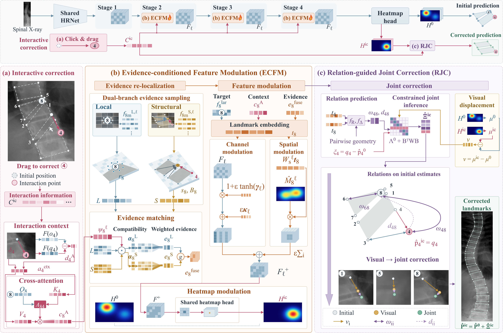

# EM-CGI: Evidence-Modulated Constrained Graph Inference

Core model and inference-only release for the initial manuscript submission.

**Training code is intentionally withheld while the manuscript is unpublished. This repository does not provide training entry points, optimization loops, loss functions, training recipes, or dataset preparation scripts.**

EM-CGI uses Evidence-conditioned Feature Modulation (ECFM) and Relation-guided Joint Correction (RJC) for interactive vertebral landmark correction.

EM-CGI combines automatic landmark localization with correction-conditioned visual inference and a constrained displacement solver. Confirmed landmarks act as exact constraints; unconfirmed landmarks are updated using image evidence and learned structural relations.

## Framework overview



**EM-CGI framework.** Accumulated landmark confirmations guide Evidence-conditioned Feature Modulation (ECFM), which samples and matches local and structural evidence to update localization features. Relation-guided Joint Correction (RJC) combines visual displacements, learned relations and relative corrections while preserving confirmed coordinates exactly.

[View the full-resolution image](assets/emcgi-framework.png) · [Download the PDF](assets/emcgi-framework.pdf)

## Release scope

This release includes the framework figure and the model architecture, correction evidence and feature modulation, relation weighting, relative correction prediction, and joint constrained localization. A synthetic example exercises automatic prediction and cumulative corrections.

Training and evaluation pipelines, dataset preparation and splits, pretrained weights, learned structural priors, experiment logs, ablation scripts, manuscript files and clinical data are not included. This is a core method release, not a complete reproduction package for the manuscript's numerical results. The example uses random weights and an artificial prior and cannot reproduce reported accuracy.

## Setup and quick start

Use Python 3.10 or later and install PyTorch for your platform. From this repository root:

```sh
python -m pip install -r requirements.txt
python -m examples.synthetic_demo
```

The example runs on CPU without downloads or external data. Its reduced image size and four landmarks are solely for checking the interface. Default model settings use 68 landmarks and an image size of 1024 × 512 (height × width).

## Repository structure

```text
emcgi/
  config.py              Model architecture and inference settings
  compatibility.py       Model schema and state validation
  models/
    model.py             Automatic and interactive forward paths
    backbone.py          Multi-resolution visual backbone
    visual.py            Shared visual encoder and heatmap head
    evidence.py          Candidate search, matching and evidence modulation
    interaction.py       Correction-conditioned feature and relation updates
    relations.py         Edge weights and relative correction prediction
    geometry.py          Heatmap decoding and constrained localization
    residual.py          Displacement system and exact click constraints
examples/
  synthetic_demo.py      Data-free cumulative correction example
```

See [the core API documentation](docs/CORE_API.md) for tensor conventions and interaction history. See [third-party notices](THIRD_PARTY_NOTICES.md) for backbone attribution.

## Method

ECFM is implemented in `evidence.py` and `interaction.py`; RJC uses `relations.py`, `geometry.py` and `residual.py`.

The shared visual encoder predicts landmark heatmaps. Local heatmap decoding estimates positions and unary precisions. During an interaction sequence, automatic positions, unary means and precisions define a fixed detached reference. Confirmed corrections condition candidate search and visual feature updates. Learned positive edge weights and relative corrections enter the displacement objective:

```text
E(delta) = sum_i ||delta_i - v_i||²_(U0_i)
         + lambda_int sum_(i,j) ||delta_i - delta_j - d_ij||²_(s_ij W_ij)
p = p0 + delta
subject to delta_c = confirmed_c - p0_c for confirmed landmarks c
```

The sequence reference stays fixed across clicks. A correction does not guarantee improvement at every unconfirmed landmark.

## Availability and use

No dataset, checkpoint or trained prior is distributed. Real-image inference requires compatible trained parameters and a prior constructed using authorized training data with the same landmark order and coordinate convention. No publication identifier or citation is provided in this initial submission release.

Third-party components retain their original notices. No project-wide license has been assigned in this release; the authors should select one before granting broader reuse rights.
